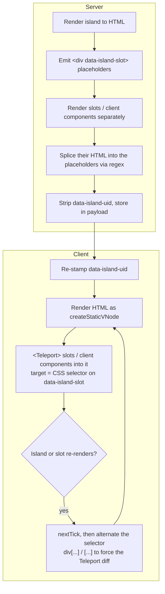
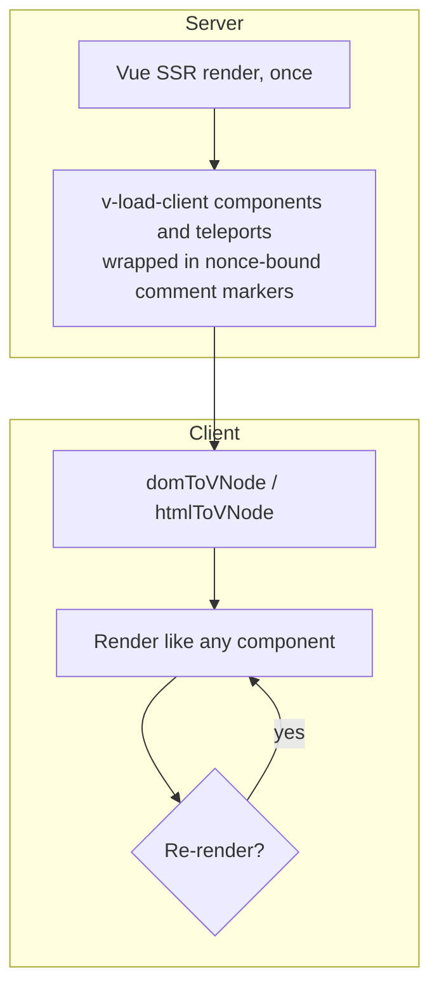

# vue-onigiri monorepo 🍙

<!-- automd:badges color=yellow -->

<!-- /automd -->

Vue Onigiri brings React Server Components-style rendering to Vue. An island renders once with Vue's own SSR renderer, components marked with `v-load-client` get nonce-bound comment markers, and the client rebuilds VNodes from the DOM. Only the marked components ship their JS to the browser.

## Motivation

This package has been created after multiple issues on maintaining [Nuxt Islands](https://nuxt.com/docs/4.x/api/components/nuxt-island) which uses HTML.

[Nuxt Islands](https://nuxt.com/docs/4.x/api/components/nuxt-island), when it comes to Slots and loading components within the island is quite complex to make it work.

Basically, you have to be aware of Vue's render mechanism. When the island, one of its slots or a client component within it is re-rendered, we have to trick re-teleport.

Every step leans on how Vue's renderer, `<Teleport>` and static VNodes happen to behave, and each Vue release is a chance for one of them to break.

vue-onigiri removes the problem instead of patching it: slots and `v-load-client` components travel inside the HTML as comment markers, and the client turns that HTML into an ordinary VNode tree.

## Entry points

One package, [`vue-onigiri`](packages/vue-onigiri), split by where the code runs:

| Import               | Runs in    | Description                                                 |
| -------------------- | ---------- | ----------------------------------------------------------- |
| `vue-onigiri`        | Browser    | DOM to VNode walker, loader plugin, marker contract         |
| `vue-onigiri/server` | SSR        | Nonce setup and the marker-writing render helpers           |
| `vue-onigiri/vite`   | Build time | Vite plugins and the `v-load-client` SSR template transform |

## License

MIT - see `LICENSE`.

## Credits

- [@antfu](https://github.com/antfu) for naming this package 💖
